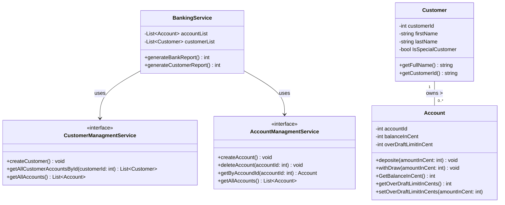

# 2. Domain Modeling, User Stories & Architecture

## 2.1 Domain Model (Mermaid Class Diagram)

## 2.2 System Architecture

CLI -> BankingService

## 2.3 User Stories & Gherkin Acceptance Criteria

## 2.3 User Stories & Acceptance Criteria

Die folgenden User Stories bilden die direkte Grundlage für die späteren **End-to-End-Tests (E2E)** über das CLI-Frontend (`REQ-012`).

---

### `US-01`: Konto ohne Startguthaben eröffnen (`REQ-001`, `REQ-010`, `REQ-013`)
**Als** Bankmitarbeiter **möchte ich** ein neues Konto mit einer 8-stelligen Konto-ID und $0\text{ Cents}$ Startguthaben für einen Kunden eröffnen, **um** diesem ein leeres Konto bereitzustellen.

**Akzeptanzkriterien:**
* **Given** die Konto-ID `12345678` ist noch nicht vergeben
* **When** ich ein Konto mit ID `12345678`, Kundenname `"Max Mustermann"` und `0` Cents Startguthaben erstelle
* **Then** wird das Konto im Status `ACTIVE` mit einem Saldo von `0` Cents gespeichert.

---

### `US-02`: Konto mit Startguthaben eröffnen (`REQ-002`, `REQ-010`, `REQ-013`, `REQ-018`)
**Als** Bankmitarbeiter **möchte ich** ein neues Konto mit einem positiven Startguthaben eröffnen, **um** die Ersteinzahlung des Kunden direkt bei der Kontoerstellung zu verbuchen.

**Akzeptanzkriterien:**
* **Given** die Konto-ID `87654321` ist noch nicht vergeben
* **When** ich ein Konto mit ID `87654321`, Kundenname `"Max Mustermann"` und `15000` Cents Startguthaben erstelle
* **Then** wird das Konto mit einem Saldo von `15000` Cents gespeichert.
* **And** eine Erstellung mit negativem Startguthaben (z. B. `-100` Cents) wird mit einer Fehlermeldung abgelehnt.

---

### `US-03`: Ungültige oder doppelte Konto-ID ablehnen (`REQ-010`)
**Als** Bankmitarbeiter **möchte ich**, dass ungültige oder bereits existierende Konto-IDs bei der Kontoeröffnung blockiert werden, **um** Eindeutigkeit und Formatkonformität im System sicherzustellen.

**Akzeptanzkriterien:**
* **Given** das Konto `12345678` existiert bereits (aktiv oder geschlossen) im System
* **When** ich versuche ein Konto mit `00000000`, `1234` (nicht 8 Ziffern) oder `12345678` (Duplikat) zu eröffnen
* **Then** schlägt die Kontoeröffnung mit einer Fehlermeldung fehl und es wird kein neues Konto angelegt.

---

### `US-04`: Kontodetails abrufen (`REQ-003`, `REQ-015`)
**Als** Bankmitarbeiter **möchte ich** die Details eines bestehenden Kontos abfragen, **um** Konto-ID, Kundenname, Status, Overdraft-Limit und aktuellen Kontostand einzusehen.

**Akzeptanzkriterien:**
* **Given** das Konto `12345678` gehört `"Max Mustermann"` und hat `25000` Cents Saldo
* **When** ich die Kontodetails für `12345678` abfrage
* **Then** erhalte ich Konto-ID `12345678`, Name `"Max Mustermann"`, Status `ACTIVE` und Saldo `25000` Cents.
* **And** die Abfrage einer nicht existierenden Konto-ID (`99999999`) liefert eine `AccountNotFoundException`.

---

### `US-05`: Konto schließen (`REQ-004`, `REQ-020`)
**Als** Bankmitarbeiter **möchte ich** ein Konto mit einem Kontostand von exakt $0\text{ Cents}$ schließen, **um** nicht mehr benötigte Konten dauerhaft für weitere Buchungen zu sperren.

**Akzeptanzkriterien:**
* **Given** das aktive Konto `12345678` hat einen Saldo von `0` Cents
* **When** ich das Konto `12345678` schließe
* **Then** wechselt der Kontostatus auf `CLOSED` und weitere Ein-/Auszahlungen, Overdraft-Änderungen oder erneutes Schließen werden mit einer `AccountClosedException` abgelehnt.
* **And** ein Schließversuch bei einem Saldo ungleich `0` Cents (z. B. `500` Cents oder `-500` Cents) wird abgelehnt.

---

### `US-06`: Geld auf ein Konto einzahlen (`REQ-006`, `REQ-014`, `REQ-020`)
**Als** Bankmitarbeiter **möchte ich** einen positiven Betrag in Cents auf ein aktives Konto einzahlen, **um** das Guthaben des Kunden zu erhöhen.

**Akzeptanzkriterien:**
* **Given** das aktive Konto `12345678` hat einen Saldo von `10000` Cents
* **When** ich `5025` Cents auf das Konto einzahle
* **Then** beträgt der neue Kontostand `15025` Cents.
* **And** Einzahlungen von `0` Cents oder negativen Beträgen (`-500` Cents) werden abgelehnt, ohne den Saldo zu verändern.

---

### `US-07`: Geld von einem Konto abheben (`REQ-005`, `REQ-014`, `REQ-017`, `REQ-020`)
**Als** Bankmitarbeiter **möchte ich** einen positiven Betrag in Cents von einem aktiven Konto abheben, **um** dem Kunden Bargeld innerhalb seines Guthabens (inkl. Overdraft) auszuzahlen.

**Akzeptanzkriterien:**
* **Given** das aktive Konto `12345678` hat `10000` Cents Saldo und `0` Cents Overdraft-Limit
* **When** ich `4000` Cents abhebe
* **Then** beträgt der neue Kontostand `6000` Cents.
* **And** eine Abhebung von `10001` Cents (über dem verfügbaren Rahmen) oder `0` Cents wird abgelehnt und der Saldo bleibt unverändert.

---

### `US-08`: Overdraft-Limit gewähren und anpassen (`REQ-007`, `REQ-016`, `REQ-019`)
**Als** Bankmitarbeiter **möchte ich** für ein einzelnes Konto ein Overdraft-Limit festlegen oder nachträglich ändern, **um** ausgewählten Kunden eine vereinbarte Kontoüberziehung zu ermöglichen.

**Akzeptanzkriterien:**
* **Given** das aktive Konto `12345678` hat `0` Cents Saldo
* **When** ich ein Overdraft-Limit von `50000` Cents setze und anschließend `30000` Cents abhebe
* **Then** ist die Abhebung erfolgreich und der Kontostand beträgt `-30000` Cents.
* **And** eine Reduzierung des Limits unter den aktuellen negativen Saldo (z. B. auf `20000` Cents bei `-30000` Cents Saldo) oder ein negatives Limit (`-100` Cents) wird abgelehnt.

---

### `US-09`: Kunden-Gesamtbericht erstellen (`REQ-008`, `REQ-013`)
**Als** Bankmitarbeiter **möchte ich** einen Gesamtbericht für einen bestimmten Kundennamen generieren, **um** dem Kunden eine Übersicht aller seiner Konten samt Gesamtsaldo zur Einsicht bereitzustellen.

**Akzeptanzkriterien:**
* **Given** `"Max Mustermann"` besitzt Konto `11111111` (`10000` Cents) und Konto `22222222` (`-2500` Cents)
* **When** ich den Kundenbericht für `"Max Mustermann"` generiere
* **Then** listet der Bericht beide Konten mit ihren Einzelsalden auf und weist einen Gesamtsaldo von `7500` Cents aus.

---

### `US-10`: Bank-Gesamtbericht erstellen (`REQ-009`)
**Als** Bankmitarbeiter **möchte ich** einen Gesamtbericht über alle Konten der Bank generieren, **um** den aktuellen Gesamtsaldo aller Kundeneinlagen und -überziehungen zu prüfen.

**Akzeptanzkriterien:**
* **Given** in der Bank existieren Konten mit den Salden `10000` Cents, `20000` Cents und `-5000` Cents
* **When** ich den Bank-Gesamtbericht generiere
* **Then** enthält der Bericht alle Konten und weist einen Bank-Gesamtsaldo von `25000` Cents aus.

---

### `US-11`: Interaktive Steuerung über das CLI-Frontend (`REQ-012`)
**Als** Bankmitarbeiter **möchte ich** alle Bankfunktionen über ein interaktives Konsolenmenü (CLI) auswählen und ausführen, **um** das System ohne direkte Code-Aufrufe bedienen zu können.

**Akzeptanzkriterien:**
* **Given** die CLI-Anwendung wurde gestartet
* **When** ich im Hauptmenü eine Aktion auswähle, die abgefragten Parameter eingebe und anschließend das Programm beende
* **Then** führt das System die gewünschte Aktion aus, zeigt das Ergebnis bzw. eine verständliche Fehlermeldung auf der Konsole an und beendet sich sauber beim Beenden-Befehl.